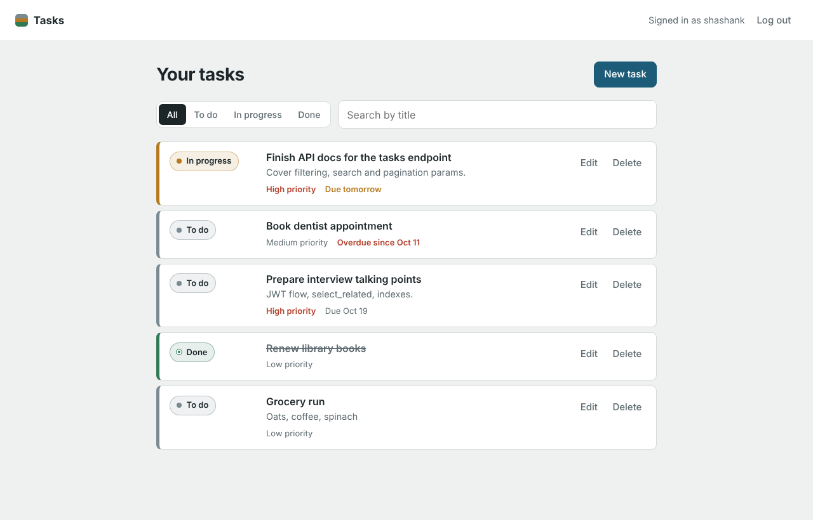
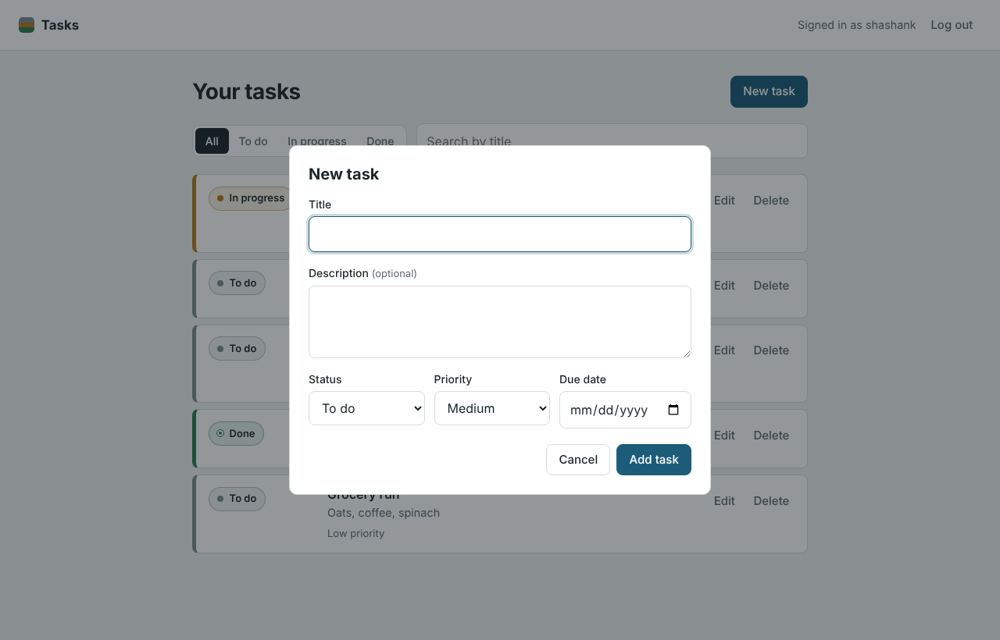
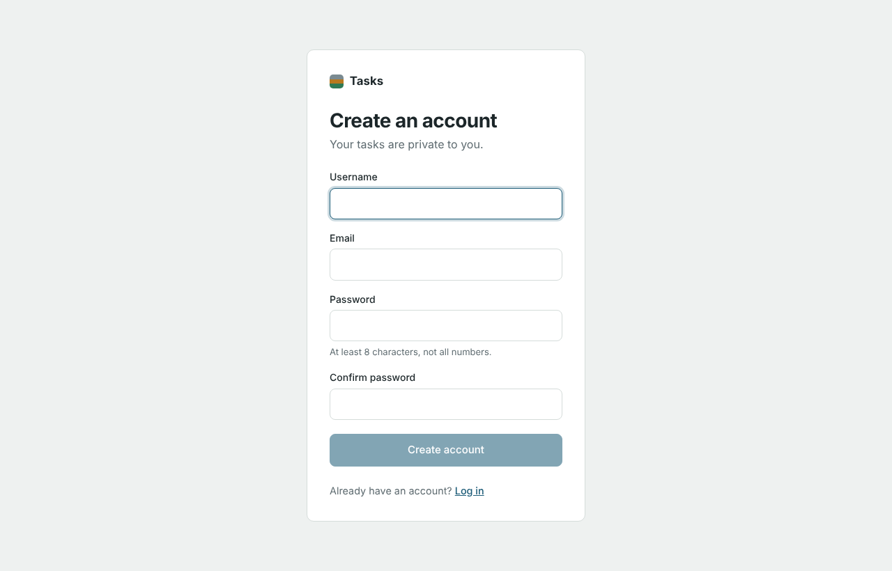
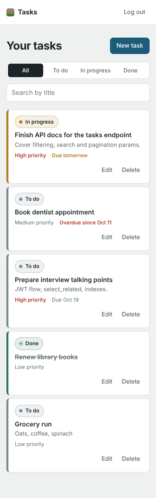
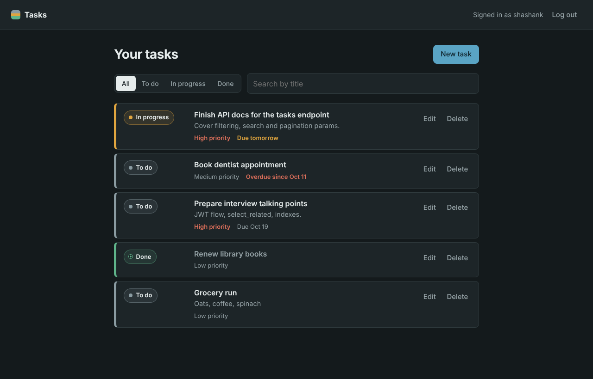

# Task Manager

A full-stack task manager where each user signs up, logs in, and manages a private list of tasks. The backend is a REST API built with Django and Django REST Framework using JWT authentication; the frontend is a React single-page app built with Vite.

## Features

- **Accounts**: sign up, log in, log out with JWT (access + refresh tokens). Logging out blacklists the refresh token on the server.
- **Tasks CRUD**: create, view, edit, and delete tasks. Each task has a title, description, status (to do / in progress / done), priority (low / medium / high), and an optional due date.
- **Private data**: every query is scoped to the logged-in user. Requesting another user's task returns 404.
- **Filtering and search**: filter by status (and priority or due-date range via the API), search by title.
- **Quick status change**: click a task's status to move it to the next one.
- **Performance**: paginated list (10 per page), `select_related` to avoid N+1 queries, composite database indexes on the fields used for filtering and sorting.
- **UX**: loading and error states, empty states, overdue/due-soon highlighting, responsive layout, dark mode.
- **Tests**: 13 pytest tests covering auth, CRUD, data isolation, filtering, pagination, validation, and query count.

## Tech stack

| Layer | Tools |
| --- | --- |
| Backend | Python 3.11+, Django 5, Django REST Framework, djangorestframework-simplejwt, django-filter, django-cors-headers |
| Database | SQLite (local development) |
| Frontend | React 19, Vite, React Router, Axios |
| Testing | pytest, pytest-django |

## Screenshots

| Task list | Add/edit form |
| --- | --- |
|  |  |

| Sign up | Mobile | Dark mode |
| --- | --- | --- |
|  |  |  |

## Project structure

```
task-manager/
├── backend/                 Django project
│   ├── config/              settings, root URLs, WSGI/ASGI
│   ├── accounts/            sign up, log out, current user
│   ├── tasks/               Task model, API, filters, permissions, tests
│   ├── manage.py
│   ├── pytest.ini
│   └── requirements.txt
├── frontend/                React app (Vite)
│   ├── src/
│   │   ├── api/             axios client, token handling, API calls
│   │   ├── context/         AuthContext (logged-in user state)
│   │   ├── components/      TaskRow, TaskForm, ProtectedRoute, ...
│   │   └── pages/           LoginPage, SignupPage, TasksPage
│   └── package.json
└── docs/screenshots/
```

## Getting started

You need **Python 3.11+** and **Node.js 20+**. Run the backend and frontend in two separate terminals.

### 1. Backend (Django API on http://localhost:8000)

```bash
cd backend

# Create and activate a virtual environment
python -m venv .venv
source .venv/bin/activate          # Windows: .venv\Scripts\activate

# Install dependencies
pip install -r requirements.txt

# Create the database tables
python manage.py migrate

# (Optional) create an admin user for http://localhost:8000/admin/
python manage.py createsuperuser

# Run the tests
pytest

# Start the API server
python manage.py runserver
```

### 2. Frontend (React app on http://localhost:5173)

```bash
cd frontend
npm install
npm run dev
```

Open http://localhost:5173, create an account, and start adding tasks.

The frontend calls `http://localhost:8000/api` by default. To point it elsewhere, copy `frontend/.env.example` to `frontend/.env.local` and change `VITE_API_URL`.

### Configuration

The backend reads these environment variables (see `backend/.env.example`). The defaults are for local development only.

| Variable | Default | Purpose |
| --- | --- | --- |
| `DJANGO_SECRET_KEY` | insecure dev key | Signs sessions and JWTs. **Always set in production.** |
| `DJANGO_DEBUG` | `True` | Set `False` in production. |
| `DJANGO_ALLOWED_HOSTS` | `localhost,127.0.0.1` | Hostnames the server answers to. |
| `CORS_ALLOWED_ORIGINS` | `http://localhost:5173,http://127.0.0.1:5173` | Frontend origins allowed to call the API. |

## API reference

All task endpoints require the header `Authorization: Bearer <access token>`.

| Method | Endpoint | Description |
| --- | --- | --- |
| POST | `/api/auth/register/` | Create an account (`username`, `email`, `password`, `password2`) |
| POST | `/api/auth/login/` | Get `access` and `refresh` tokens |
| POST | `/api/auth/refresh/` | Exchange a refresh token for a new access token |
| POST | `/api/auth/logout/` | Blacklist a refresh token |
| GET | `/api/auth/me/` | Current user |
| GET | `/api/tasks/` | List your tasks (paginated) |
| POST | `/api/tasks/` | Create a task |
| GET | `/api/tasks/{id}/` | Get one task |
| PUT / PATCH | `/api/tasks/{id}/` | Update a task |
| DELETE | `/api/tasks/{id}/` | Delete a task |

**Query parameters for `GET /api/tasks/`:**

| Parameter | Example | Meaning |
| --- | --- | --- |
| `status` | `?status=in_progress` | `todo`, `in_progress`, or `done` |
| `priority` | `?priority=high` | `low`, `medium`, or `high` |
| `search` | `?search=report` | Title contains the text (case-insensitive) |
| `due_before` / `due_after` | `?due_before=2026-12-31` | Due-date range |
| `ordering` | `?ordering=due_date` | `created_at`, `due_date`, or `title`; prefix `-` for descending |
| `page` | `?page=2` | Page number (10 tasks per page) |

Example:

```bash
curl -H "Authorization: Bearer $TOKEN" "http://localhost:8000/api/tasks/?status=todo&search=report"
```

## Design decisions

- **Token storage**: the access token (15-minute lifetime) is kept only in memory; the refresh token is kept in `localStorage` so a reload keeps you logged in. Refresh tokens rotate on every use and are blacklisted on logout. A production deployment would move the refresh token into an `httpOnly` cookie so JavaScript can't read it.
- **Data isolation**: the queryset is filtered by the current user, so other users' tasks return 404 rather than 403. This avoids revealing which task IDs exist.
- **Indexes**: every task query filters by `owner`, so each index starts with `owner` followed by `status`, `priority`, `due_date`, or `created_at`.
- **Validation lives on the server**: the frontend checks a few things for fast feedback, but the API validates everything again.

## Possible next steps

- Move the refresh token to an `httpOnly` cookie
- PostgreSQL and a Docker Compose setup
- Deploy (e.g. Render or Railway for the API, Netlify or Vercel for the frontend)
- Frontend tests with Vitest and React Testing Library
- Tags or projects for grouping tasks
